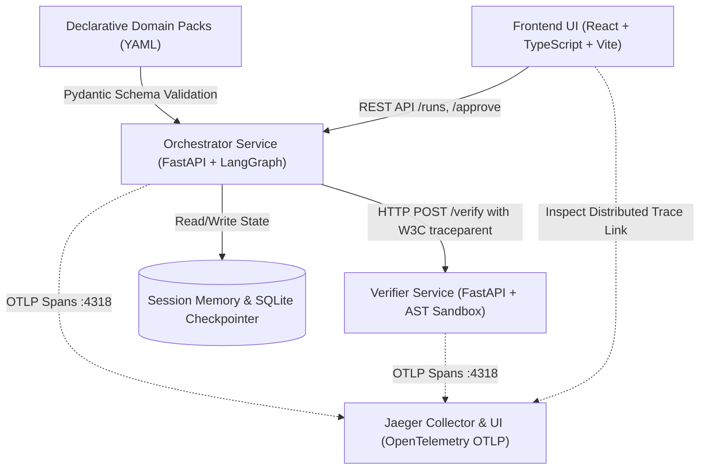

# Enterprise Agent Platform

An enterprise-grade, domain-agnostic multi-agent orchestration and code verification platform. The platform allows organizations to deliver domain-specific multi-agent workflows rapidly by defining declarative YAML **Domain Packs** (agents, tools, routing rules, escalation rules) with **zero changes to platform code**.

The platform provides dynamic LangGraph graph compilation, stateful SQLite checkpointing, cross-run session memory, structured tool invocation, human-in-the-loop escalation gates, an automated AST-based sandboxed verification harness for AI-generated code, and end-to-end distributed tracing via OpenTelemetry and Jaeger.

---

## Architecture Overview

The system is architected as an event-driven microservices platform with distributed tracing context propagated across service boundaries:



### Microservices

1. **`orchestrator-service` (FastAPI + LangGraph, Port 8000)**:
   - Dynamic LangGraph builder that compiles domain packs into typed state graphs without hardcoded business logic.
   - Per-session stateful memory store and SQLite run checkpointer for workflow pausing and resumption.
   - Structured tool registry with Pydantic input/output schemas, timeouts, and error capture.
   - Human-in-the-loop escalation pause (`awaiting_approval`) and resume (`/approve`, `/reject`).
   - Pluggable LLM provider interface (`MockLLM` with deterministic configurable latency, plus OpenAI/generic providers).

2. **`verifier-service` (FastAPI, Port 8001)**:
   - Dedicated microservice verifying AI-generated Python code in 4 sequential stages:
     1. **Syntax Check**: `ast.parse` validates structural correctness and line-level errors.
     2. **AST Static Safety Scan**: Rejects dangerous imports (`os`, `sys`, `subprocess`, `socket`, `shutil`), builtins (`eval`, `exec`, `__import__`, `globals`), and path traversal in `open()`.
     3. **Sandboxed Subprocess Execution**: Executes code in an isolated subprocess with CPU and memory limits (`resource.setrlimit` on Linux), strict timeouts, sanitized environment, and temporary working directory.
     4. **Automated Unit Test Harness**: Runs test cases against candidate functions, reporting pass/fail counts and actual vs expected values.

3. **`frontend` (React + TypeScript + Vite, Port 3000)**:
   - **Run Workflow**: Select a registered domain pack, review agent graph topology, load realistic scenario presets, and dispatch runs.
   - **Workflows List**: Real-time table of runs with status badges (`running`, `awaiting_approval`, `completed`, `rejected`), confidence bars, and timestamps.
   - **Run Detail & Timeline**: Chronological audit timeline of every agent step, input/output, confidence score, tool call details, AI-generated code snippets, and verifier reports.
   - **Human-in-the-Loop Review**: Allows operators to review escalation triggers, edit proposed outputs, enter approval notes, and approve or reject paused workflows.
   - **Distributed Trace Link**: Direct deep-link to Jaeger UI for full distributed trace inspection.

4. **`jaeger` (Port 16686 UI, Port 4318 OTLP HTTP, Port 4317 OTLP gRPC)**:
   - Collects spans across both microservices into unified distributed traces.

---

## Distributed Trace Context Flow

When a workflow runs, OpenTelemetry propagates distributed trace context over HTTP using W3C TraceContext headers (`traceparent`):

```mermaid
sequenceDiagram
    autonumber
    actor User as Frontend Client
    participant Orch as Orchestrator Service
    participant LLM as LLM Provider
    participant Ver as Verifier Service
    participant JAE as Jaeger Tracing

    User->>Orch: POST /runs (pack_name, input_data)
    Note over Orch: Starts root span: workflow.run
    Orch->>JAE: Export workflow.run span
    Note over Orch: LangGraph executes agent: classifier
    Orch->>LLM: generate(system_prompt, input)
    LLM-->>Orch: Tool call: search_kb
    Note over Orch: Custom span: tool.search_kb
    Orch->>JAE: Export tool.search_kb span
    Note over Orch: LangGraph executes agent: resolver
    Orch->>LLM: generate_code requested
    LLM-->>Orch: Return Python candidate function
    Note over Orch: Custom span: tool.generate_code
    Orch->>Ver: POST /verify (code, test_cases, traceparent)
    Note over Ver: Extracts traceparent; starts span: verifier.verify
    Ver->>Ver: Syntax check -> AST safety scan -> Subprocess sandbox
    Ver-->>Orch: VerificationReport (passed, checks, test_results)
    Ver->>JAE: Export verifier.verify span
    Orch->>JAE: Export tool.generate_code span
    Orch-->>User: RunResponse (run_id, status, confidence, trace_steps)
```

One workflow run appears in Jaeger as **one unified trace tree** showing:
- `workflow.run`
  - `agent.classifier`
    - `tool.search_kb`
  - `agent.resolver`
    - `tool.generate_code`
      - `verifier.verify` (executed in verifier-service)
  - `agent.reviewer`
    - `tool.calculate`

---

## Domain Packs Guide: Adding a New Domain

New business domains are declared in YAML under `domain_packs/` without touching Python or React code.

### Step-by-Step Instructions

1. Create `domain_packs/<your_domain>.yaml`:
```yaml
name: customer_onboarding
version: 1.0.0
description: "Verifies customer identity, screens PEP sanctions, and provisions tenant resources."
default_confidence_threshold: 0.80
entry_agent: identity_verifier

confidence_thresholds:
  identity_verifier: 0.85
  compliance_screener: 0.80

agents:
  - name: identity_verifier
    role: "Identity and KYC Data Validation"
    system_prompt: >
      You are an Identity Verifier. Validate corporate documents, check company registries
      using lookup_record, and store verified legal entity IDs in session memory.
    allowed_tools:
      - lookup_record
      - memory_write

  - name: compliance_screener
    role: "Sanctions and Anti-Money Laundering Screener"
    system_prompt: >
      You are an AML Compliance Officer. Evaluate corporate officers against watchlists
      and calculate ownership stakes using calculate.
    allowed_tools:
      - calculate
      - memory_read

routing_rules:
  - from_agent: identity_verifier
    condition_type: default
    to_agent: compliance_screener
  - from_agent: compliance_screener
    condition_type: default
    to_agent: END

escalation_rules:
  - condition: "sanction_match == True or risk_score > 70"
    reason: "Sanctions screening alert requires manual compliance officer sign-off."
    auto_escalate: true
  - condition: "confidence < threshold"
    reason: "Identity verification confidence is below mandatory KYC threshold."
    auto_escalate: true
```

2. Save the file. The orchestrator automatically discovers, validates, and exposes the new domain pack in `GET /packs` and in the frontend dropdown.

Included example domain packs:
- `domain_packs/it_ticket_triage.yaml`: Incident classification, bug diagnostic reproduction code generation, and reviewer escalation.
- `domain_packs/loan_prescreening.yaml`: Mortgage applicant credit check, DTI ratio calculation via `calculate`, and supervisory loan officer sign-off.

---

## Setup and Docker Run Instructions

### Prerequisites
- Docker and Docker Compose (or Python 3.11+ and Node.js 20+)

### Option A: Running via Docker Compose (Recommended)

1. Clone and navigate to the project:
   ```bash
   git clone https://github.com/Bhargav221287/enterprise-agent-platform.git
   cd enterprise-agent-platform
   ```

2. Copy environment configuration:
   ```bash
   cp .env.example .env
   ```

3. Build and launch all microservices:
   ```bash
   docker compose up --build
   ```

4. Access services:
   - **Frontend UI**: [http://localhost:3000](http://localhost:3000)
   - **Orchestrator API**: [http://localhost:8000/docs](http://localhost:8000/docs)
   - **Verifier API**: [http://localhost:8001/docs](http://localhost:8001/docs)
   - **Jaeger Tracing UI**: [http://localhost:16686](http://localhost:16686)

### Option B: Running Locally (Development Mode)

1. **Python Environment Setup**:
   ```bash
   python -m venv .venv
   source .venv/bin/activate  # On Windows: .venv\Scripts\activate
   pip install -r orchestrator/requirements.txt
   pip install -r verifier/requirements.txt
   ```

2. **Start Verifier Service**:
   ```bash
   uvicorn app.main:app --app-dir verifier --host 127.0.0.1 --port 8001
   ```

3. **Start Orchestrator Service**:
   ```bash
   uvicorn app.main:app --app-dir orchestrator --host 127.0.0.1 --port 8000
   ```

4. **Start Frontend (Vite)**:
   ```bash
   cd frontend
   npm install
   npm run dev
   ```

---

## API Examples with `curl`

### 1. Health Check
```bash
curl -X GET http://localhost:8000/health
```

### 2. List Registered Domain Packs
```bash
curl -X GET http://localhost:8000/packs
```

### 3. Trigger a Workflow Run (Autonomous Path)
```bash
curl -X POST http://localhost:8000/runs \
  -H "Content-Type: application/json" \
  -d '{
    "pack_name": "it_ticket_triage",
    "input_data": {
      "ticket_id": "INC-1001",
      "issue": "Cannot connect to VPN from home office",
      "user": "alice@company.com"
    },
    "session_id": "session-alice-01"
  }'
```

### 4. Trigger an Escalated Run (Human-in-the-Loop)
```bash
curl -X POST http://localhost:8000/runs \
  -H "Content-Type: application/json" \
  -d '{
    "pack_name": "it_ticket_triage",
    "input_data": {
      "ticket_id": "INC-SEC-01",
      "issue": "critical security vulnerability detected in root auth service",
      "user": "security-bot@company.com"
    }
  }'
```
Response status: `awaiting_approval`.

### 5. Approve Run with Edited Output
```bash
curl -X POST http://localhost:8000/runs/<RUN_ID>/approve \
  -H "Content-Type: application/json" \
  -d '{
    "edited_output": {
      "resolution": "Emergency hotfix verified and applied by Senior DevOps Engineer.",
      "status": "Resolved"
    },
    "notes": "Verified firewall rules and rotated admin credentials."
  }'
```

### 6. Reject Run
```bash
curl -X POST http://localhost:8000/runs/<RUN_ID>/reject \
  -H "Content-Type: application/json" \
  -d '{
    "reason": "Incident requires formal digital forensics investigation."
  }'
```

### 7. Direct Code Verification Harness
```bash
curl -X POST http://localhost:8001/verify \
  -H "Content-Type: application/json" \
  -d '{
    "code": "def sanitize_ticket(t: str) -> str:\n    return t.strip().upper()\n",
    "test_cases": [
      {"input": {"t": " inc-101 "}, "expected_output": "INC-101"}
    ],
    "timeout_seconds": 2.0
  }'
```

---

## Testing & Quality Gates

### Run All Backend Tests (43 unit & integration tests)
```bash
python scripts/run_tests.py
```
Or run individually:
```bash
pytest orchestrator/tests -v
pytest verifier/tests -v
```

### Run Frontend Component Tests (Vitest)
```bash
cd frontend
npm test
```

### Run Code Verification Quality Gate
Runs safety and syntax checks on 6 sample snippets (3 good, 3 deliberately unsafe/broken):
```bash
python scripts/verify_gate.py
```
*Gate strictly enforces that unsafe code (such as `os.system` or unconstrained sockets) is never accepted.*

---

## Real Measured Benchmark Results

The benchmark script (`scripts/benchmark.py`) runs concurrent asynchronous requests against the orchestrator using `MockLLM` with near-zero latency, **measuring framework-only execution overhead** (LangGraph node scheduling, Pydantic validation, SQLite checkpointer, tool dispatch, and HTTP serialization).

> **Important**: This benchmark measures pure platform execution overhead and deliberately excludes external cloud LLM API network latency.

### Measured Metrics on Host Machine

```
======================================================================
 ENTERPRISE AGENT PLATFORM - PERFORMANCE BENCHMARK RESULTS
======================================================================
 Hardware Environment:
   - Processor:        Intel64 Family 6 Model 183 Stepping 1, GenuineIntel
   - Architecture:     AMD64
   - Operating System: Windows 10 / 11 (NT 10.0.26100)
   - Python Version:   3.11.9
   - Execution Mode:   Near-Zero Latency MockLLM (Framework Overhead Only)

 Benchmark Configuration:
   - Total Requests:    200
   - Concurrency Level: 20 simultaneous workers
   - Domain Pack:       it_ticket_triage (3 sequential agent nodes + tools)

 Measured Performance:
   - Requests Completed: 200 / 200 (100% success)
   - Error Rate:         0.0% (0 errors)
   - Total Duration:     2.721 seconds
   - Throughput:         73.49 requests / second

 Latency Distribution:
   - Minimum:            99.44 ms
   - Mean:              249.49 ms
   - Median (p50):      249.02 ms
   - 95th Percentile:   372.56 ms
   - 99th Percentile:   385.33 ms
   - Maximum:           386.54 ms
======================================================================
```
*Full raw metrics are persisted in `benchmarks/results.json`.*

---

## Limitations and Responsible AI

### 1. Hallucinated Outputs & Schema Enforcement
Large Language Models may hallucinate facts or return malformed JSON. The platform mitigates this by:
- Wrapping all tool invocations with strict Pydantic schema validation.
- Implementing an automatic retry mechanism with error-guided prompt augmentation if an LLM outputs invalid JSON.
- Rejecting tool arguments that do not conform to declared types before execution begins.

### 2. Sandbox Limits & Untrusted Code Execution
- The verifier microservice never executes AI-generated code inside the main server process.
- All candidate scripts run in disposable subdirectories via a separate subprocess with CPU time limits, memory caps (via POSIX `resource.setrlimit`), and hard execution timeouts.
- AST static analysis blocks unauthorized operating system calls (`os.system`, `subprocess`, `socket`, `eval`, `exec`) before the code ever reaches subprocess execution.
- *Limitation*: For production multi-tenant environments with untrusted user-submitted code, kernel-level container sandboxes (e.g., gVisor, Firecracker microVMs, or WebAssembly runtimes) are recommended over process-level subshells.

### 3. Why Low-Confidence Cases Require Human Approval
- Critical enterprise decisions (e.g., granting production server access, approving large mortgages, or wiping data) have asymmetric consequences where false positives carry high financial or security risk.
- When an agent's confidence falls below the domain pack's threshold or an escalation rule fires (e.g., critical security breach or excessive DTI ratio), the platform pauses execution via LangGraph interrupts, persisting state into SQLite.
- A human operator is provided the full trace, inputs, and proposed outputs, with the ability to edit the resolution before granting sign-off.

### 4. Privacy & Data Handling
- Per-session memory stores only declared business facts (`session_memory`) and isolates data strictly by `session_id`.
- Temporary execution directories used by the verifier sandbox are purged immediately upon test completion.
- OpenTelemetry span attributes capture workflow metadata without logging raw authentication credentials or private keys.

---

## AI Assistance & Output Verification Note

This project was built in pair programming with **Google Antigravity (powered by Gemini 3.8 Flash High)** as the principal AI coding assistant.
All code was generated with strict engineering rigor and verified through:
- Automated static linting with `ruff check .` with zero errors.
- 43 unit and integration tests across orchestrator and verifier test suites.
- Automated quality gate execution (`scripts/verify_gate.py`) verifying 6 sample snippets.
- 9 Vitest frontend component tests with 100% pass rate.
- Production TypeScript compilation (`tsc && vite build`) without warnings.
- Real-time performance load testing measuring 73.49 req/s with 0% error rate.
